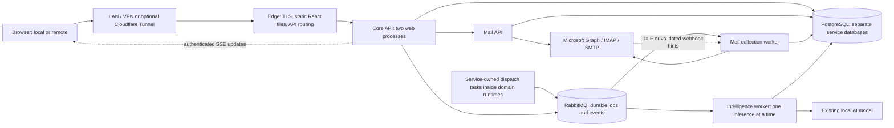

# OfferPath: microservices on one Windows 11 server

Status: proposed architecture; no production migration or runtime change implemented.

Baseline: v2.27.17, commit c4d13eb. Work branch: feature/major-update-v2.27.17.

## Requirements and constraints

- Windows 11, Intel Core i5-12400 (6 cores / 12 threads), 16 GB DDR4.
- Approximately 10 concurrent users today; design and test for 50 within six months.
- One physical server; no cloud compute, managed database, or hosted message broker.
- Preserve the existing AI model and its classification behavior initially.
- Keep Cloudflare Tunnel as an optional remote access layer. Local/LAN operation must not depend on it.
- Preserve accounts, passwords, OAuth connections, workspace isolation, bidder permissions, sourcing history, classifications, assignments and recorded payments.
- Preserve a tested rollback path. A Git branch alone is not a data rollback plan.

This is a small set of independently deployable business services, not a service per screen or user. One physical server remains a single point of failure. Containers can isolate workload failures; they cannot provide high availability through a host power failure, disk failure or Windows reboot. Capacity is a benchmark target, not a guarantee based on CPU specifications alone.

## Chosen approach and alternatives

Recommended: three business domains, a static edge, PostgreSQL and RabbitMQ, deployed with Docker Compose using Linux containers under Docker Desktop/WSL2. Keep the repository unified but give each service an independent entry point, image, schema migrations, database credentials, health checks and test suite.

Alternatives considered:

1. Retain the existing application and extract only background jobs. Lowest migration risk, but leaves the current core/worker coupling and data-access assumptions substantially intact.
2. Split every feature into its own service. Adds network calls, memory overhead, distributed transactions and more operational failure points without a demonstrated need at 50 concurrent users.

The recommended scope provides independent web, mailbox and AI capacity without requiring a cluster manager or a larger operations team. Do not introduce Kubernetes, Elasticsearch, Redis, a service mesh or a separate authentication product in the first migration.

## Deployment topology

Mail API and collector are two runtime roles of the same mail service and share only that service's database. Each domain runs its own outbox dispatcher using only its own database role. There is no central dispatcher with all database credentials. Domain schedulers claim due work in their own database; any cross-domain scheduling command uses an authenticated domain API or event. These tasks run within the existing domain runtimes initially, with leases preventing duplicates across replicas.

## Service boundaries and data ownership

| Domain | Responsibilities | Authoritative data |
| --- | --- | --- |
| Core service | Authentication and revocation, owners/admins/bidders, workspaces, assignments, job sourcing, payment rules and ledgers, dashboard and pipeline workflows, notification delivery; browser-facing API | core database: identity, tenant membership, sourcing, payment history, pipeline decisions, audit, recipient notification records and a minimal live client-event journal; local mail-derived projections for reporting |
| Mail service | Provider credentials and OAuth refresh, mailbox cursors, incremental collection, normalized/original messages, queue Done/Undo, reply sending, raw calendar collection, live provider watches and authorized inbox reads | mail database: accounts and encrypted credentials, messages, action state, provider cursors, send ledger, raw calendar events |
| Intelligence service | Existing classification pipeline and model cache, calendar interpretation and job-link matching; background inference only | intelligence database: versioned results, cache entries, attempts and review state; results published as events |

One PostgreSQL instance initially hosts three logical databases with separate application roles. A service cannot query or write another service's tables. Internal HTTP and versioned events connect domains. No cross-database foreign keys or distributed SQL transactions. Service-owned projection tables can contain copies of relevant facts; their source, revision and lag must be explicit.

Use tombstones and retained external IDs for deleted accounts/workspaces rather than cross-service delete cascades. Mail removal must not erase Core payment history or historical sourcing references. Cross-domain references are validated through contracts and reconciled; they are not assumed to be database foreign keys.

Core remains a deliberate domain grouping. Separating payments, authentication or sourcing is a later option if measurements or ownership justify it, not a prerequisite for this migration.

## Intelligence contracts and retention

Proposed versioned internal contracts must replace today's direct joins across message, calendar and sourcing tables:

- Mail publishes a job with source ID, input revision and a source-retention lease. Intelligence fetches an immutable, bounded input through `GET /internal/v1/messages/{id}/snapshots/{revision}` or the equivalent calendar snapshot endpoint, authenticated as the Intelligence service and scoped to the eligible workspace/account.
- Core supplies authorized historical sourcing candidates and bidder attribution through `GET /internal/v1/sourcing/candidates`, with account, application-date bounds, pagination and a snapshot revision. Intelligence never queries Core's tables directly.
- Intelligence persists the accepted input snapshot and versions before acknowledging the job, then emits `classification.completed.v1`, `calendar.analysis.completed.v1` or `job-match.completed.v1`, including input revision, result revision and model/prompt versions.
- Mail validates classification results against current input revisions/manual overrides, commits accepted inbox state and emits authoritative classified-message facts. Core derives inbox/report/payment projections and related alerts from these Mail-accepted facts, never directly from an unaccepted Intelligence completion. Direct matching/calendar evidence is a versioned suggestion for the owning domain to validate; it cannot overwrite authoritative manual corrections.

Rolling mail retention must not delete inputs still needed by queued work. Mail pins the required source revision until Intelligence durably accepts its bounded snapshot; Intelligence then owns retention of that copy until completion/review expiry. Pending outboxes and broker outages must not create dangling ID-only jobs. Leases and snapshot lifetimes are bounded: an expired/administratively deleted input produces an explicit cancelled/needs-review state, not an invented result or endless retry. Deletion and privacy workflows must include pinned copies and snapshots. The migration must preserve existing retention behavior outside these explicitly tracked in-flight inputs.

## Browser and synchronous request path

1. Edge serves React, icons and CSS without touching Python, mail providers or the model. Deploy complete versioned assets atomically, keep HTML non-cacheable and hashed files immutable, and retain previous assets for the supported open-tab lifetime. Do not overwrite the active asset directory during a deployment.
2. Browser calls the Core API using the existing same-origin route contract where practical.
3. Core validates the current session, selected workspace, user role and relevant account assignments.
4. Core serves sourcing, payments and reports from its own database. It calls the Mail API for inbox/message functions with authenticated, audience-bound internal authorization containing the permitted workspace, role and account scope.
5. Mail enforces this scope again. Browser-supplied workspace IDs and internal-looking headers never grant access.

Core and Mail must not share end-user session cookies as service credentials. Internal service credentials and authorization signing keys are mounted as restricted files. No browser can route directly to Mail, PostgreSQL, RabbitMQ, the collector or the model through the edge.

Revocation is authoritative in Core and checked on every browser request; do not make permission decisions from a long-lived cached JWT or a delayed membership projection. Service assertions are short lived and cannot extend the authenticated request's authorization.

Use bounded database pools and deadlines. Starting targets: local HTTP connect 1–2 seconds, ordinary API response budget 10 seconds, and no more than one retry for safe reads. Never automatically retry a send or another non-idempotent action. Do not make page readiness depend on mailbox collection or inference completing.

## Background work and durable delivery

- Store a business change and its outbox event in the same transaction within the owning service.
- Dispatchers publish persistent RabbitMQ messages with publisher confirms. A broker outage leaves the outbox pending; it must not discard accepted work.
- Consumers acknowledge only after their local transaction commits. Delivery is at least once, not exactly once.
- Every event has event_id, type, schema_version, workspace_id, entity_id, revision, occurred_at and correlation_id. Events reference message IDs rather than carrying unnecessary email bodies or credentials.
- Each consumer records processed event IDs and applies monotonic revisions. Duplicate or out-of-order events cannot double-count receipts or reverse newer state.
- Use bounded retry queues and a persisted failed-job/review state. No immediate requeue loops. A failed inference must not continuously refetch a mailbox.
- An account has one collection lease and one token-refresh lease. Leases have expiry and fencing tokens so a late worker cannot overwrite a newer cursor or token.
- Scheduling uses database-backed due times and leases, not one browser timer or process per workspace. Multiple scheduler instances must not launch duplicate runs.
- RabbitMQ is a persistent single-node broker here. Durable queues survive a process restart when its disk remains intact; this is not a replicated quorum or a host-failure guarantee.

Begin with four global mailbox fetch slots, one active collection per account, and one model request at a time. Respect provider Retry-After and rate limits. Reserve a fast collection lane for live application-code mail so a historical import cannot monopolize every slot. These are initial limits to tune from measurements.

Before executing queued work, revalidate workspace/account eligibility. A suspended workspace must not continue consuming provider or AI capacity merely because its jobs were queued earlier. If authoritative eligibility cannot be checked, defer work rather than assume access. Already dispatched provider operations require reconciliation; suspension cannot recall a sent email.

Store newly fetched mail before inference. Existing deterministic job-application verification-code handling and permission rules must remain available without waiting for the AI queue. Preserve the current model, prompts and counting semantics until comparison tests approve any change.

Email sending requires a durable operation ID and send ledger. If the provider may have accepted a send but acknowledgement was lost, mark it uncertain and require review; do not claim SMTP can provide exactly-once delivery or blindly resend after a worker restart.

## Cross-domain reporting and payments

Core consumes versioned mail/classification events into reporting projections. Receipt counts remain receipt-based, matching the accepted product behavior. Preserve historical deduplication keys and receipt ownership; never use queue redelivery as an additional application.

Receipt-derived payment calculations need a consistency gate, not just a freshness label. Mail must provide an immutable, period/account-scoped classification-fact snapshot with a source watermark and sync/analysis completeness status. Core waits until the corresponding facts are available, derives the financial calculation using a consistent local snapshot, and stores its source manifest. The review token binds that manifest, source watermark, assignments, sourcing revision, deduction-rule revision, payment revision and calculated cents. Recording a payment validates the token and locks/rechecks Core's relevant revisions in one transaction; changed or incomplete inputs produce a conflict/deferred response requiring a fresh review. If the source is unavailable, do not present a stale calculation as current. Explicitly define settlement as "as of the reviewed snapshot," rather than claiming a distributed transaction can include every concurrently arriving email. Later receipts are flagged for reconciliation and do not silently rewrite a recorded payment. Preserve the existing explicit manual-override workflow and its authorization/audit semantics; distinguish an acknowledged manual amount from an automatic receipt-derived calculation rather than silently changing payment policy during the migration.

Display projection/sync freshness. A new deployment must not quietly change paid weeks, assigned dates, deduction rules, overrides, currency rounding or Chicago day boundaries. Recorded payments remain immutable unless an existing authorized workflow explicitly edits them. Daily deduction eligibility continues to exclude today/future days and use completed weekdays with active assignments.

Keep raw calendar events owned by Mail and interpreted evidence owned by Intelligence; Core owns confirmed pipeline decisions and their audit history. Classification or matching updates cannot overwrite manually confirmed corrections.

## Live mailbox updates

Live collection is a server responsibility, shared per account rather than initiated by each browser. Mail uses provider change hints where available (Graph subscriptions or IMAP IDLE), durable incremental cursors and a polling/reconciliation fallback. It commits new mail and its outbox before publishing an update; Intelligence runs independently afterward.

Core reuses the notification module's authenticated SSE transport for minimal data-change events, with durable replay and current account/role authorization. Data invalidation events and human notifications remain separate records/policies. React refreshes affected queries without resetting filters, selection, scroll or drafts. Unclassified mail does not automatically become a receipt or gain bidder visibility.

The provider-specific design, safeguards, timing targets and migration tests are specified in [Live mailbox collection and browser updates](REALTIME_MAIL_UPDATES.md). This extends the existing three-service/resource budget; it adds no fourth service or cloud messaging dependency. New live-update settings must clearly distinguish server collection from browser delivery and historical/full checks.

## Notification delivery: begin inside Core

Decision: use a separately bounded notification module in Core, not a fourth business service in the initial deployment. At 10–50 concurrent users on a 16 GB PC, a separate process/database adds operating cost without a measured scaling benefit. Give the module a stable contract and repository boundary so it can be extracted later if its workload or ownership warrants it.

- Core consumes authoritative Mail facts and Core-accepted workflow decisions, then commits recipient-scoped notification rows plus its consumed-event record in one Core transaction. Uniqueness on source event, recipient and notification kind makes redelivery harmless. RabbitMQ acknowledgement follows the commit.
- Core owns notification permissions and read/unread state. A message's Done state, provider read flag and notification read state are distinct; opening or acknowledging a notification must not mark the real mailbox read.
- Start with the current supported alert types. Job-application verification alerts must use the existing restricted bidder eligibility and fast collection path, not wait for model inference or expose unrelated account-login/reset codes. Alert previews contain no verification code or sensitive message body. Suppress popup storms from historical imports; use an explicit backfill/summary policy rather than treating old messages as new arrivals.
- Preserve the existing same-origin notification list/ack routes during migration. Add an authenticated SSE stream for incremental in-app delivery and a separate explicit read-state operation. SSE events contain a notification ID, cursor and minimal event metadata; fetch private content through the normal authorized API.
- Persist events before delivery. On reconnect, validate the cursor against the authenticated identity/workspace, replay authorized records after Last-Event-ID, and use notification IDs to deduplicate in the client. If retention has removed the cursor, return an explicit resync signal and fetch current notification state. Reconnect with bounded backoff/jitter rather than reload the page.
- Two Core API processes must both learn about new rows. PostgreSQL LISTEN/NOTIFY provides a lightweight wake-up to each process, with ID-only payloads; notification records in PostgreSQL remain the source of truth. On listener reconnect, scan durable records to cover missed wake-ups. Do not assume RabbitMQ competing consumers broadcast to every process. Budget one listener connection per API process within the existing database connection limit; no Redis dependency is required.
- Authorize every stream and delivery against the current session, workspace and permitted accounts. Revocation closes affected streams; permission checks also occur before fetching content. Do not accept a user/workspace identifier in the URL as authorization. Bound event replay batches and send queues; slow clients reconnect/resync instead of consuming unlimited memory.
- Keep long-lived SSE connections in a separate admission budget from ordinary API requests. Initially allow at most two streams per authenticated user across replicas using expiring claims, and 60 streams per API process; validate these budgets for 50 users plus normal page requests. Streaming lifetime is exempt from the ordinary short API deadline, while idle/heartbeat limits and revocation still apply. Browser tabs should share one connection where feasible. Edge buffering/compression settings must support streaming and heartbeats, with idle timeout behavior tested both locally and through the optional tunnel.
- Browser Notification API popups remain opt-in and best effort while the app is open. Use a short server-side delivery claim plus acknowledgement to reduce duplicate popups across tabs/processes. Failed popup creation is not acknowledged as successful; displayed-popup acknowledgement is separate from the user's read state. Exactly-once desktop display cannot be guaranteed after a browser crash. In-app delivery remains usable if desktop permission is denied.

No external notification provider, notification database, extra container, or always-running browser push service is needed initially. Closed-browser/mobile push is outside the initial scope and must not be promised by an SSE design. Extract the notification module only after measurement shows it needs independent capacity or operational ownership; preserve its contracts and migrate its owned tables then.

## Resource budget for the actual 16 GB host

Use Linux containers under Docker Desktop/WSL2. Keep PostgreSQL and broker data in Docker named volumes on the Linux filesystem; do not bind-mount live database data into an ordinary NTFS project folder.

Initial maximum memory budgets to validate, not measured requirements:

| Runtime | Starting count | Memory ceiling |
| --- | --- | --- |
| Core API | 2 web processes | 768 MiB total |
| Mail API | 1 process | 384 MiB |
| Collection worker | 1 process, bounded I/O slots | 512 MiB |
| Intelligence worker, excluding the model | 1 | 256 MiB |
| Scheduling/dispatch overhead within domain runtimes | bounded service-owned tasks | 128 MiB reserved total |
| PostgreSQL | 1 | 1,024 MiB |
| RabbitMQ | 1 | 512 MiB |
| Edge | 1 | 64 MiB |

These ceilings total about 3.6 GiB, before WSL/container overhead. Start with a 5 GiB WSL memory limit and up to eight logical CPUs for Docker, then measure. Leave the remaining host memory for Windows, the existing model and headroom. Resource-limit support must be verified in the chosen Compose/Desktop versions rather than assumed from YAML alone.

Retain the existing model placement initially. If it already runs on Windows, expose it only to the private container-to-host path with firewall rules; container localhost does not refer to Windows localhost. No public model port. Do not silently move its weights into the limited WSL memory budget.

Measure the current model's peak RAM and CPU during realistic batches. If Windows plus the model cannot fit comfortably alongside the approximately 5 GiB container allocation, reduce model context/batch load only with classification-quality validation, or increase host RAM. Keeping the exact existing model and serving 50 users on 16 GB cannot be guaranteed before this measurement. AI concurrency remains one, with CPU priority/limits preventing inference from monopolizing interactive capacity.

Use PostgreSQL shared_buffers around 256 MiB initially and conservative per-query memory. Keep all application pools plus maintenance connections below a reserved connection budget, initially 40 of a 60-connection limit. Do not allocate a large pool independently to every process.

RabbitMQ messages should be small, with bounded queues and disk alarms. Broker memory pressure pauses publishing; accepted outbox work remains durable in PostgreSQL. Disk-space monitoring and retention must cover the database, mailbox content, broker, model and logs.

## Phase zero: mandatory feasibility gates

Before committing to the production runtime or implementing a data cutover, measure idle and peak Windows/model memory with the actual loaded model and its current context/batch settings. Reproduce a collection/classification burst alongside the proposed container memory budget. The existing configuration permits an 8,192-token context; an unknown model size means 16 GB fit remains unproven. Record measured peaks and explicit headroom, not just configured limits.

Unattended Windows startup is a go/no-go gate. Rehearse a cold reboot without interactive login, automatic service startup and recovery after a failed container. Docker Desktop/WSL2 is the initial candidate, but user-logon autostart alone does not meet this gate. Document the exact verified mechanism under a dedicated account. If Desktop cannot satisfy it, evaluate a separately managed WSL2 Docker Engine with Windows startup supervision in an isolated deployment spike; do not enable automatic Windows login or put passwords in scripts as a workaround. If neither meets the operational requirement, resolve that deployment constraint before production migration.

## Windows operation and external access

- Compose owns service start order, restart policies, health checks, image versions and named volumes. A healthy API is not restarted solely because the model or a mail provider is unavailable.
- Test a cold Windows boot, locked session and logged-out operation. Docker Desktop's normal user-logon startup is not proof of unattended server availability. The final operating procedure must establish and verify the required startup behavior on this PC.
- Configure no sleep/hibernation during service hours, controlled update/reboot windows and protected power where available. Avoid automatic restart storms with bounded health/recovery rules.
- Local access goes through the same edge as remote access. Cloudflare Tunnel, if enabled, forwards to one stable edge listener, not rotating Python worker ports. Only trust forwarded headers from that connector.
- Publish the edge only to the interfaces needed for LAN/VPN or the local tunnel connector. Do not publish database, broker management, application-service or model ports to the LAN/internet.
- Keep HTTPS, session security, CSRF protection and the restrictive CSP. Optional analytics failures cannot affect application startup.
- Cloudflare remains an external dependency for clients using its tunnel. A single-host microservice deployment cannot repair Cloudflare DNS errors, connector outages or the host's internet connection.

## Security, backups and visibility

Use least-privilege service roles and separate migration roles. Enforce workspace scoping in every domain query; composite uniqueness must include workspace identity where appropriate. Test owner switching, bidder read-only access, expired sessions and cross-workspace entity IDs.

Mailbox secrets are encrypted at rest; the master key is outside the database and source repository, mounted only where needed. Docker Compose file secrets are protected files, not an independent secret vault. Apply Windows ACLs and protect any WSL-visible paths. Back up recovery keys separately from database backups.

Emit structured logs with request/job correlation IDs, service name, operation, latency and outcome. Keep mail bodies, passwords, OAuth tokens and cookies out of logs. Propagate sanitized Cloudflare Ray IDs for remote correlation. Rotate logs on disk. Include service readiness, mailbox lag, inference backlog, outbox lag, provider throttling, disk usage and database pool usage in an owner-only status view.

Back up all service databases at a coordinated migration/job checkpoint, along with the encrypted credential material, versions, settings and recovery manifest. Broker queues must not be the only record of accepted work. Reconcile/restage pending jobs from outboxes after restore. A copy on the same physical SSD is insufficient protection; test restoring a backup to separate storage.

## Migration and rollback

1. Inventory existing workspaces, database versions, credentials, provider IDs, assignments, payment ledgers and model settings. Capture current performance and error baselines.
2. Create a reproducible Compose deployment and build artifacts without replacing production. Implement readiness, restricted networking and local diagnosis first.
3. Define stable internal contracts and PostgreSQL migrations. Extract persistence interfaces from sqlite3-dependent code without changing business semantics; do not pretend the SQL dialect can be replaced with a connection-string edit.
4. Build an offline SQLite-to-PostgreSQL importer. Import existing owner/admin/bidder password records with their salt, hash, algorithm parameters, revocation versions and forced-change flags. Plan one fresh sign-in at cutover rather than silently trusting legacy cookies in the new identity service. Preserve every legacy ID using a mapping keyed by workspace plus legacy ID; IDs from separate SQLite files can collide. Preserve provider/message uniqueness, UTC timestamps, Chicago reporting boundaries and historical monetary values.
5. Migrate Windows Credential Manager secrets through an explicitly local, privileged export/import tool into encrypted Mail storage. Containers cannot read the host's keyring automatically. If a credential cannot be exported safely, reconnect that mailbox through OAuth; never save plaintext exports in the repository or logs.
6. Import a consistent backup into a shadow environment. Compare row counts, foreign-key integrity, role access, queue state, application totals, assignments, deductions and recorded payments. Replay stored examples without sending real mail or double-polling production accounts.
7. Introduce Mail and Intelligence behind compatible routes and contracts. Validate projection freshness and idempotency. Move long-running work out of request handlers.
8. Run realistic load and failure tests on the actual PC. Approve capacity and rollback before cutover.
9. During a short maintenance window, stop writers and collectors, take a final consistent backup, import the final state, reconcile pending/uncertain sends, verify totals and switch the stable edge upstream. One system is authoritative for writes at a time.
10. Keep the legacy installation and backup intact. Before new writes, rollback can restore the old edge route and checkpoint. After new writes or provider sends, rollback requires a rehearsed reverse export and reconciliation of send-ledger IDs, cursors and payment changes; never simply point users at an older database.

Do not promise zero downtime or automatic lossless rollback after arbitrary new writes. Rehearse the actual procedure before production use.

## Acceptance gates

- All existing backend/frontend tests remain passing, supplemented by contract and PostgreSQL integration tests.
- Cross-workspace access and revoked-session tests cover every domain; no service trusts a browser-provided tenant header.
- On this PC: 50 concurrent sessions for at least 30 minutes with realistic inbox polling, dashboard reads, sourcing edits and controlled provider/model simulation. Measure p50/p95/p99 latency, CPU, RAM, disk, queue lag and errors. Initial goals: ordinary local API p95 below 500 ms, p99 below 2 seconds, with no unhandled failures or OOMs under the defined load. Provider/model completion times are reported separately.
- Test short 100-user bursts and confirm bounded 429/503 backpressure rather than crashes or unlimited queues. This is overload testing, not a claim of 100-user supported capacity.
- Crash/restart Mail, Intelligence, the broker and the API independently. The UI remains usable where its dependencies permit; completed jobs are not counted twice, lost acknowledgements are reconciled and sends are not blindly replayed.
- Test SSE reconnection, missed wake-ups, revoked sessions, cross-account authorization, slow clients, desktop-permission denial, duplicate/backfill events and two API processes without duplicate notification rows or unbounded streams. Test stale socket recovery, interrupted asset/CSS downloads and complete builds through the actual edge. Also test tunnel disconnection separately from local origin failure.
- Verify backup restore, migration equivalence, cold boot, protected internal ports, disk-pressure behavior and post-write rollback reconciliation.

## Implementation sequence

Deliver in reviewable phases: phase-zero host/runtime feasibility; deployment skeleton and contracts; Core/PostgreSQL persistence and importer; Mail extraction and credential migration; durable scheduling/outboxes; Intelligence extraction; live mailbox change delivery and browser streaming; then end-to-end rehearsal and production cutover. Each phase needs a working local result and explicit validation. This document does not deploy containers, alter current data or constitute a completed migration.
